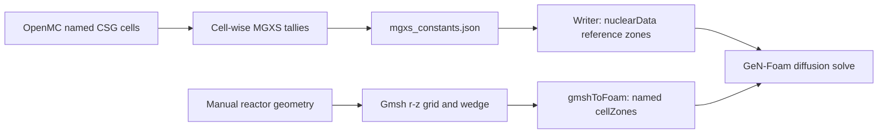

# GeN-Foam Concentric Reactor Case

This directory contains an axisymmetric GeN-Foam diffusion model of the
concentric OpenMC reactor.

It is an offline neutronics case. It does not supply the webapp or Modelica
FMU with power, and its mesh and cross-section conversion are independent of
the Python four-group Core-page solver.

## How OpenMC Was Homogenized

The current case uses the **resolved, cell-wise** export. There are two
different meanings of "cell": an OpenMC CSG cell defines a tally domain; an
OpenFOAM mesh cell is a finite volume in the diffusion solve. One OpenMC
domain supplies constants to many OpenFOAM cells.

`openmc/mgxs_export.py::_build_mgxs_library()` sets `domain_type="cell"` and
`by_nuclide=False`. For ordinary reaction cross sections, OpenMC forms a
macroscopic, flux-weighted reaction-rate-to-flux ratio over the selected
spatial domain and energy group:

```math
\overline{\Sigma}_{x,i,g} =
\frac{\int_{V_i}\int_{E_g}^{E_{g-1}}\Sigma_x(\mathbf r,E)\phi(\mathbf r,E)\,dE\,dV}
     {\int_{V_i}\int_{E_g}^{E_{g-1}}\phi(\mathbf r,E)\,dE\,dV}.
```

This preserves that domain's reference reaction rate for the reference flux
integral. Scattering matrices also resolve outgoing energy; diffusion
coefficients and delayed-neutron data have their own tally definitions. See
the [OpenMC MGXS definition](https://docs.openmc.org/en/stable/pythonapi/generated/openmc.mgxs.TotalXS.html).

The 12 configured domains in the published concentric model are:

| OpenMC cell name | MGXS label and GeN-Foam `cellZone` | Constants shared across |
| --- | --- | --- |
| `fuel_ring_1` through `fuel_ring_7` | `core_fuel_ring_1` through `core_fuel_ring_7` | Each ring separately, over its whole height and circumference |
| `central_moderator_channel` | `core_central_moderator_channel` | The central channel |
| `control_rod` | `core_control_rod` | The parked rod above the active core |
| `heavy_water_coolant_and_moderator` | `core_heavy_water_coolant_and_moderator` | The core coolant spaces represented by this one CSG cell |
| `d2o_tank` | `moderator` | The outer heavy-water moderator domain |
| `h2o_tank` | `reflector` | The light-water reflector domain |

Fuel rings and coolant are kept separate. The workflow does not mix all fuel
and coolant into one homogenized core material. Even regions filled with the
same material can have different collapsed constants because their spectra
and tally domains differ. Within one domain, axial and other spatial spectral
variation is averaged out.

The exporter also supports an earlier `supercell` option with the parent
`fuel_element` as one core domain. That is a different homogenization choice.
The concentric GeN-Foam mesh and `fuelFraction` assignments described here are
designed for the resolved domains, not a drop-in supercell export.

## How Constants Reach The Mesh



`gmsh_reactor_mesh.py` owns the material boundaries, radial/axial subdivision
counts, and region classifier. It builds an independent, boundary-fitted
`r-z` grid and revolves it into a thin wedge. Every block receives a region
label; Gmsh physical volume groups collect all blocks with that label.
`gmshToFoam` imports these groups as OpenFOAM `cellZones`.

`openmc_to_genfoam_xs.py` writes one group-constant vector/matrix per domain
under `states ( reference { zones (...) } )`. The zone names match the mesh
groups exactly. GeN-Foam assigns that zone's constants to its finite volumes
and solves for spatially varying flux. This is the
[GeN-Foam cellZone property mechanism](https://foam-for-nuclear.gitlab.io/GeN-Foam/user_guide/).

For example, the current default grid has three radial subdivisions and 12
axial subdivisions in each fuel ring: 36 wedge blocks per ring all receive
the **same ring MGXS**, while their solved fluxes can differ. Across all
regions the current default grid has 41 radial by 20 axial intervals, or 820
blocks. These are defaults computed from the source, not a guarantee that an
existing local mesh was generated with those settings.

There is no OpenMC MGXS tally per Gmsh block, no interpolation of XS onto a
fine tally mesh, and no fresh nuclear data when only the Gmsh mesh is refined.
The export's cylindrical CE power tally is separate diagnostic/reference data;
this GeN-Foam writer does not use it to homogenize or correct mesh-cell power.

Two independent resolutions therefore matter:

- **Homogenization resolution:** the OpenMC domains over which constants are
  collapsed. Finer axial constants require new axial domains/tallies and an
  updated domain-to-zone mapping.
- **Numerical resolution:** the Gmsh/OpenFOAM finite volumes used to solve
  diffusion with those constants. Refinement improves the discretization but
  retains the original domain averaging.

## Prerequisites

- OpenFOAM and foamForNuclear available in the shell
- the `openmc` Conda environment with OpenMC, Gmsh, and `MultiGroupXS`
- the tracked four-group OpenMC publication under
  `openmc/reference_data/concentric/group_sweep/group_4/`

Four groups is the current preparation default. It does not describe every
historical run: the local generated case inspected on 2026-10-14 recorded a
16-group rerun from the former `openmc/build/concentric/mgxs_export` path.
Check the case manifest, XS summary, and `nuclearData` `energyGroups` entry
to identify a run. Generated files and stored logs can outlive changes to
the preparation defaults.

Run Python commands from the repository root with the `openmc` environment
active, or use `conda run -n openmc` as shown below.

## Workflow

The workflow has three distinct stages:

1. `prepare_concentric_case.py` reads or regenerates MGXS data, writes
   GeN-Foam `nuclearData` and initial flux files, and generates the Gmsh
   `.msh` file and mesh manifest.
2. `Allmesh` imports that prepared `.msh` file with `gmshToFoam`, configures
   patches and cell zones, runs `checkMesh`, and validates the import. It does
   not regenerate the Gmsh geometry.
3. `Allrun` calls `Allmesh` and then runs GeN-Foam.

For the first run, or after changing MGXS settings:

```bash
conda run -n openmc python genfoam/prepare_concentric_case.py --rerun-mgxs
cd genfoam
./Allclean
./Allrun
```

Without particle-count overrides, `--rerun-mgxs` reuses the run settings
recorded in the source export. The current four-group publication records
20,000 particles, 100 batches, and 10 inactive batches.

Once a compatible MGXS export exists, preparation can reuse it without an
OpenMC run:

```bash
conda run -n openmc python genfoam/prepare_concentric_case.py
```

`Allclean` removes time directories, imported `polyMesh`, and logs. It keeps
the prepared files under `constant/generated/`, so `Allrun` can re-import the
same mesh without rerunning OpenMC or Gmsh.

## Geometry And Mesh

The active geometry is a thin axisymmetric wedge representing the reactor
`r-z` plane. Dimensions and canonical region names are maintained manually
from the OpenMC reference model; `model.xml` is not parsed to construct the
Gmsh geometry.

The mesh preserves material boundaries and uses independent radial and axial
subdivision counts. Default controls are defined by `MeshSizingDefinition` in
`gmsh_reactor_mesh.py`. Geometry dimensions are not changed when the mesh is
refined.

To generate a standalone mesh with explicit subdivisions:

```bash
conda run -n openmc python genfoam/gmsh_reactor_mesh.py generate \
  --mesh-kind axisymmetric-wedge \
  --wedge-angle-deg 1.0 \
  --fuel-radial-divisions 3 \
  --fuel-axial-divisions 12 \
  --core-radial-divisions 2 \
  --core-axial-divisions 2
```

This writes:

- `constant/generated/concentric_reactor_wedge.msh`
- `constant/generated/concentric_reactor_mesh_manifest.json`

The centerline is represented by a very small inner cylindrical symmetry
patch to avoid collapsed-axis defects during `gmshToFoam` import. `Allmesh`
rewrites the wedge and centerline patch types and validates all expected cell
zones.

The earlier full-cylinder generator remains experimental and is not used by
`Allmesh` or `Allrun`:

```bash
conda run -n openmc python genfoam/gmsh_reactor_mesh.py generate \
  --mesh-kind full-3d-experimental \
  --mesh-file genfoam/constant/generated/concentric_reactor_3d.msh
```

## MGXS Contract

`openmc/mgxs_export.py` is the MGXS source of truth. The local
`openmc_to_genfoam_xs.py` writer converts its results to the GeN-Foam
`states ( reference { zones (...) } )` syntax.

Compatible exports contain:

- `consistent nu-scatter matrix`
- `chi-prompt`
- `scatter_correction = null`
- one-group `Beta` and decay-rate kinetics data

The writer uses the P0 moment of the consistent nu-scatter matrix and computes:

```text
sigmaRemoval[g] = total[g] - scatteringMatrixP0[g,g]
```

`legendre_order=0` and `scatter_correction=None` are separate settings. P0
selects the isotropic Legendre moment; disabling the correction prevents
OpenMC from modifying its diagonal with a transport correction.

Exports created before this contract was added are rejected. Regenerate them
with `--rerun-mgxs` or rerun `openmc/exportMGXS.ipynb` after reloading the
current `mgxs_export` module. New notebook exports use the compatible defaults.

Optional preparation overrides:

```bash
conda run -n openmc python genfoam/prepare_concentric_case.py \
  --rerun-mgxs \
  --openmc-particles 2000 \
  --openmc-batches 12 \
  --openmc-inactive 4 \
  --openmc-threads 8 \
  --legendre-order 0
```

The adapter sanitizes only solver-invalid values such as non-positive
diffusion/removal coefficients in inactive or statistically unresolved groups.
Every intervention is listed in
`constant/generated/mgxs_to_genfoam_xs/summary.json`.

In particular, invalid/nonpositive removal values are replaced by the
smallest finite positive removal in that zone, even for active groups;
invalid active-group diffusion or inverse velocity raises an error.
Missing auxiliary fields can also be synthesized, and missing generation
time falls back to 1 s (`prompt_generation_time_source="fallback_constant"`).
Inspect the raw/adapted zone data and summary before treating a new case as a
physics benchmark. Successful writing and solving do not validate these
substitutions.

## Reference Comparison

`openmc_to_foam_reference.py` runs the installed openmcToFoam
`MultiGroupXS` implementation and compares it with the local export/writer.
Use identical statistics and scattering order on both sides:

```bash
conda run -n openmc python genfoam/openmc_to_foam_reference.py \
  --rerun-local-mgxs \
  --local-particles 2000 \
  --local-batches 12 \
  --local-inactive 4 \
  --openmc-to-foam-particles 2000 \
  --openmc-to-foam-batches 12 \
  --openmc-to-foam-inactive 4 \
  --local-legendre-order 0 \
  --openmc-to-foam-legendre-order 0
```

The generated comparison reports check `scatteringMatrixP0`, `chiPrompt`,
`Beta`, `lambda`, and `sigmaRemoval`. Agreement checks the conversion contract;
it does not establish agreement of the diffusion solution with transport.

## Generated And Static Files

`prepare_concentric_case.py` writes:

- `constant/neutroRegion/nuclearData`
- one initial flux field per group: `defaultFlux`, `defaultFlux2`, ..., `defaultFluxG`
- `constant/generated/concentric_case_manifest.json`
- `constant/generated/concentric_reactor_wedge.msh`
- `constant/generated/concentric_reactor_mesh_manifest.json`
- `constant/generated/concentric_mesh_regions.csv`
- `constant/generated/concentric_materials.json`
- `constant/generated/mgxs_to_genfoam_xs/`

The following static case inputs belong in version control:

- `system/controlDict` and `system/regionsDict`
- `system/neutroRegion/fvSchemes` and `fvSolution`
- `constant/neutroRegion/neutronicsProperties`
- `Allclean`, `Allmesh`, and `Allrun`

The `All*` scripts consume these dictionaries; they do not create them.
Preparation writes cross sections and initial flux fields without overwriting
the static solver dictionaries. The `.gitignore` permits these case inputs
and excludes generated `nuclearData`, initial flux files, mesh files under
`generated/` and `polyMesh/`, result time directories, and logs. Commit the
static dictionaries alongside the scripts so a fresh clone retains the solver
configuration.

## Validation And Visualization

`Allmesh` performs:

- `gmshToFoam`
- imported boundary and cell-zone configuration
- `checkMesh -region neutroRegion`
- manifest-based patch and cell-zone validation

Plot extracted results with:

```bash
conda run -n openmc python genfoam/plot_results.py
```

For ParaView:

```bash
cd genfoam
paraFoam -region neutroRegion
```

Alternatively, create `genfoam/neutroRegion.foam` and open it directly in
ParaView.
